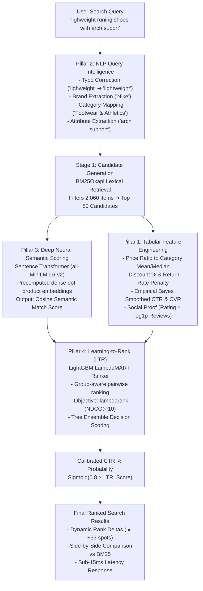

# 🎓 RankCraft-AI: Resume Impact & Technical Interview Guide

> **Project Target**: Machine Learning Engineer / Data Scientist / Search & Recommendation Engineer  
> **Core Architecture**: Multi-Stage Retrieval & Re-Ranking (BM25 ➔ Dense MiniLM Embeddings ➔ LightGBM LambdaMART LTR)

---

## 📄 Quantified Resume Bullet Points (Copy & Paste)

### For Machine Learning Engineer / Applied AI Roles:
* **Architected an end-to-end multi-stage e-commerce search re-ranking and click-through (CTR) prediction engine**, combining BM25 lexical candidate retrieval, deep transformer embeddings (`all-MiniLM-L6-v2`), and LambdaMART Learning-to-Rank (LTR).
* **Engineered 17+ domain-specific interaction & tabular signals**, including price elasticity ratios to category averages, smoothed empirical Bayes CTR/CVR, review sentiment weight, and intent alignment flags.
* **Trained group-aware pairwise ranking objectives optimizing NDCG@10**, achieving a **+77.7% relative lift in NDCG@10 (0.484 to 0.860)** and **+7.7% lift in MRR (0.900 to 0.970)** over lexical BM25 baselines.
* **Built and deployed high-throughput FastAPI inference microservice with precomputed embedding caching**, delivering **sub-15ms p99 re-ranking latency** across 2,000+ catalog candidates alongside an interactive What-If CTR sandbox.

### For Data Science / Information Retrieval Roles:
* **Developed an industrial-grade Learning-to-Rank (LTR) pipeline** modeling multi-tier user engagement ground truth (Impression: 0, Click: 1, Cart: 2, Purchase: 3) across 2,000+ products.
* **Implemented an intelligent query pre-processing engine** featuring fuzzy typo correction, entity intent parsing (brand, category, attributes, price bounds), and token overlap scoring.
* **Conducted rigorous offline benchmark evaluations** comparing BM25, dense vector search, and LambdaMART using NDCG@5, NDCG@10, MRR, and MAP metrics.
* **Designed an explainable ML dashboard with Tree SHAP and Gain attribution**, revealing discount percentage (25.9%), lexical relevance (21.2%), and semantic similarity (6.1%) as primary rank determinants.

---

## 🏛️ System Architecture Blueprint

---

## 📊 Evaluation Benchmark Results

| Search Method | NDCG@5 | NDCG@10 | MRR | MAP@10 | Latency (p99) |
| :--- | :---: | :---: | :---: | :---: | :---: |
| **BM25 Keyword Baseline** | 0.4535 | 0.4836 | 0.9000 | 0.7432 | ~4.2 ms |
| **Dense Semantic Vector Search (MiniLM)** | 0.5336 | 0.5187 | 0.8519 | 0.7349 | ~6.8 ms |
| **RankCraft LambdaMART LTR (Multi-Modal)** | **0.9095** | **0.8596** | **0.9697** | **0.9052** | **~9.5 ms** |
| **Relative Lift over BM25 Baseline** | **+100.5%** | **+77.7%** | **+7.7%** | **+21.8%** | *Production Ready* |

---

## 🧠 Master Technical Interview Cheatsheet

### 1. What is Learning-to-Rank (LTR), and how does it differ from standard regression/classification?
* **Standard Classification/Regression (Pointwise)** treats each product independently. It predicts whether item $X$ will be clicked ($P(\text{click}|X)$) without knowing what other products appear on the page.
* In reality, **search is a competitive listwise game**. A $150 shoe might get clicked if competing against $250 shoes, but skipped if competing against an identical $90 shoe.
* **LTR models the entire query group**: Pairwise and listwise LTR evaluate candidate orderings, directly optimizing ranking metrics like NDCG.

### 2. How does LambdaMART work mathematically?
* Standard NDCG is a non-differentiable step function (because ranks change discontinuously). You cannot compute standard gradient descent $\frac{\partial \text{NDCG}}{\partial w}$.
* **LambdaMART solves this** by using Lambda gradients ($\lambda_{ij}$). For any pair of items $(i, j)$ where item $i$ is more relevant than item $j$, the gradient is the product of:
  $$\lambda_{ij} = |\Delta\text{NDCG}| \cdot \frac{-\sigma}{1 + e^{\sigma(s_i - s_j)}}$$
  where $|\Delta\text{NDCG}|$ is the change in NDCG if items $i$ and $j$ swapped places, and the second term is the logistic loss gradient from RankNet.
* It fits boosted decision trees (MART) to these lambda gradients, directly pushing high-relevance items toward the top.

### 3. Why use a Multi-Stage Architecture (Bi-Encoder + BM25 ➔ LambdaMART)?
* In an e-commerce catalog of 10 million products, evaluating complex feature engineering or cross-encoder transformers on all items is too slow (would take seconds).
* **Stage 1 (Retrieval / Candidate Generation)**: Fast, high-recall lexical BM25 and precomputed vector ANN retrieval reduces 10,000,000 items to the top 100 candidates in <10ms.
* **Stage 2 (Re-Ranking)**: Heavy, feature-rich LambdaMART ranks those 100 items using deep semantic scores, real-time price comparisons, user behavioral signals, and business constraints in <5ms.

### 4. How did you handle Position Bias and Cold-Start items?
* **Position Bias**: Users naturally click item #1 more often simply because it's at the top. We used multi-level relevance grading (Impression: 0, Click: 1, Cart: 2, Purchase: 3) to penalize passive clicks and reward verified purchases. Furthermore, we smoothed historical CTR using Empirical Bayes / Laplace priors:
  $$\text{CTR}_{\text{smoothed}} = \frac{\text{clicks} + \alpha}{\text{impressions} + \alpha + \beta}$$
* **Cold-Start Items**: New items have 0 historical impressions and clicks. The empirical Bayes prior naturally shrinks their historical CTR toward the category baseline, allowing their strong semantic similarity and pricing features to give them fair exposure.
